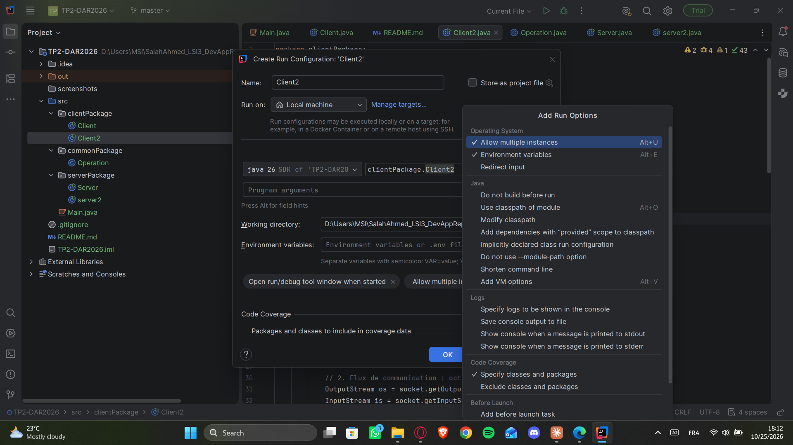
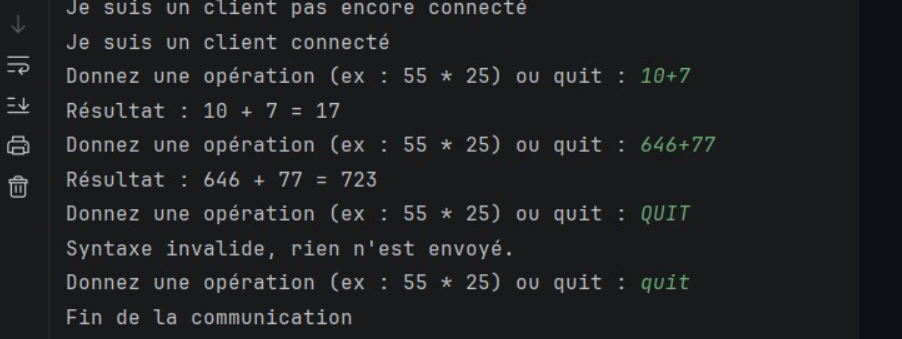
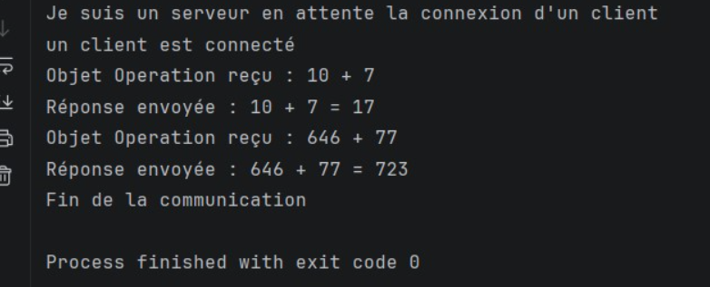

# TP2-DAR2026 — Sockets TCP : échange de chaînes de caractères et d'objets

**Matière :** Développement d'applications réparties — LSI 3
**Faculté des Sciences de Sfax** — Année universitaire 2026–2027
**Étudiant :** Salah Ahmed

---

## 1. Structure du projet

Le projet est organisé en trois packages : `clientPackage` (Client, Client2), `serverPackage` (Server, server2) et `commonPackage`, qui contient la classe `Operation` (Serializable) partagée entre le client et le serveur.

---

## 2. Exécution côté client

Le client se connecte au serveur et saisit des opérations (ex. `10+7`, `646+77`). Il reçoit le résultat calculé par le serveur, refuse les saisies invalides sans rien envoyer, et termine la communication avec `quit`.

---

## 3. Exécution côté serveur

Le serveur attend la connexion du client, reçoit chaque objet `Operation`, effectue le calcul et renvoie la réponse au client, puis ferme la communication quand le client envoie `quit`.